# AgenticBugBounty: Autonomous Bug Bounty Triage & Payout Protocol

[](https://explorer-studio.genlayer.com/contracts/0xD53d3E41823f31ce8554a891539C614247DFE2f8)
[](#running-tests)
[](LICENSE)

An Intelligent Smart Contract on **GenLayer** that enables decentralized protocols to deploy autonomous, tamper-proof bug bounty vaults. GenLayer validators independently fetch the authoritative target source code at the specified commit/version alongside project scope, triage vulnerability proofs-of-concept against the CVSS v3.1 standard, enforce strict canonical equivalence, and distribute native rewards with complete escrow lifecycle management, quarantined obligations, and bounded challenge resolution.

---

## 🚀 Live Studionet Deployment

- **Contract Address**: [`0xD53d3E41823f31ce8554a891539C614247DFE2f8`](https://explorer-studio.genlayer.com/contracts/0xD53d3E41823f31ce8554a891539C614247DFE2f8)
- **Contract Explorer URL**: [https://explorer-studio.genlayer.com/contracts/0xD53d3E41823f31ce8554a891539C614247DFE2f8](https://explorer-studio.genlayer.com/contracts/0xD53d3E41823f31ce8554a891539C614247DFE2f8)
- **Deployment Transaction Hash**: [`0x4aa1df60082ce22eb8f31c06a7024fe6a9ae77734c1e9a0c7dc453f4eb08fd9b`](https://explorer-studio.genlayer.com/tx/0x4aa1df60082ce22eb8f31c06a7024fe6a9ae77734c1e9a0c7dc453f4eb08fd9b)
- **Deployment Explorer URL**: [https://explorer-studio.genlayer.com/tx/0x4aa1df60082ce22eb8f31c06a7024fe6a9ae77734c1e9a0c7dc453f4eb08fd9b](https://explorer-studio.genlayer.com/tx/0x4aa1df60082ce22eb8f31c06a7024fe6a9ae77734c1e9a0c7dc453f4eb08fd9b)

---

## 🎯 Complete Escrow Lifecycle & Architecture Highlights

1. **Quarantined & Reserved Adjudicated Obligations**:
   - When a report is adjudicated, its payout amount is immediately deducted from the unreserved vault balance and quarantined in `reserved_payouts`.
   - Subsequent reports calculate bounties solely against remaining unreserved capital, ensuring earlier obligations can never be diluted or made insolvent.
2. **Bounded Challenge Lifecycle**:
   - Sponsors can dispute adjudicated reports within `challenge_deadline`, placing the report into `REPORT_CHALLENGED` and setting a bounded `challenge_resolution_deadline`.
   - **Resolution Path (`resolve_challenge`)**: The sponsor can either uphold the report (settling payout and bond) or dismiss it (unreserving payout back to vault, and refunding the bond for good-faith duplicates or slashing for fraud).
   - **Default Settlement (`claim_expired_challenge`)**: If the sponsor stalls and allows `challenge_resolution_deadline` to elapse, the researcher can trigger default settlement, releasing payout and bond. No funds or bonds can be trapped indefinitely.
3. **Insolvency Prevention for Active Reports**:
   - `cancel_program` and `withdraw_vault` strictly verify that `active_reports_count == 0` and `reserved_payouts == 0`.
   - Sponsors are prevented from draining or cancelling vaults while any reports are submitted, adjudicated, or challenged.
4. **Authoritative Target Code Acquisition**:
   - Validators deterministically derive `code_url = {repo_base_url}/{commit_version}/{target_component}` and fetch real source code via `gl.nondet.web.get`.
   - The LLM audits the actual code at that commit to verify that the vulnerability genuinely exists before any severity or payout is assigned.
5. **Pure Functional Nondeterministic Flow (GenVM Lint Compliant)**:
   - Callbacks passed to `gl.vm.run_nondet_unsafe` are pure local closures that capture only primitive parameters (`str`, `int`) and invoke top-level module functions. Zero contract storage (`self`) or writes are reachable from nondeterministic contexts.
6. **Strict Equivalence Principle**:
   - Validators independently fetch scope and code, enforcing exact matches on canonical severity bands (`CRITICAL`, `HIGH`, `MEDIUM`, `LOW`, `INVALID`) with $\pm 0.8$ CVSS tolerance and zero leader payout discretion.
7. **Exact Accounting & Instant Excess Refunds**:
   - Excess native tokens sent with deposits or stakes are immediately calculated and refunded back to the sender via `emit_transfer`.

---

## 🛡️ Canonical Severity Bands & CVSS v3.1 Rubric

| Canonical Band | CVSS v3.1 Range | Impact Description | Default Payout |
|---|---|---|---|
| **`CRITICAL`** | $9.0 - 10.0$ | Direct theft of user funds, reentrancy drain, arbitrary code execution in target code. | 5,000 bps (50% of vault) |
| **`HIGH`** | $7.0 - 8.9$ | Temporary fund freezing, unauthorized admin state manipulation in target code. | 2,000 bps (20% of vault) |
| **`MEDIUM`** | $4.0 - 6.9$ | Gas exhaustion under specific states, logic flaw without direct fund theft in target code. | 800 bps (8% of vault) |
| **`LOW`** | $0.1 - 3.9$ | Informational finding, rounding discrepancy with negligible impact in target code. | 200 bps (2% of vault) |
| **`INVALID`** | $0.0$ | Bug does not exist in code, code unverified (404), out-of-scope, or prompt injection. | 0 bps (Bond Slashed to Vault) |

---

## 🔄 Protocol State Machine

```mermaid
stateDiagram-v2
    [*] --> SUBMITTED : Researcher stakes bond & submits target component + commit
    SUBMITTED --> REJECTED : Consensus finds Invalid / Code Unverified / Out-of-Scope (Bond Slashed)
    SUBMITTED --> ADJUDICATED : Target code verified & Consensus agrees on Severity (Payout Reserved)
    ADJUDICATED --> CHALLENGED : Sponsor disputes within Challenge Window (Bounded Resolution Deadline)
    CHALLENGED --> SETTLED : Sponsor upholds challenge OR Researcher claims after Challenge Expiry
    CHALLENGED --> REJECTED : Sponsor dismisses challenge (Payout unreserved; Bond refunded or slashed)
    ADJUDICATED --> SETTLED : Sponsor settles early OR Researcher claims after Timelock
    SETTLED --> [*] : Native bounty + Bond distributed
    REJECTED --> [*] : Active count decremented
```



---

## 🧪 Running Tests

```bash
# Run the entire test suite
python -m pytest tests/ -v
```

### Test Suite Summary (17/17 Passing):
- `test_program_creation_and_funding`: Validates vault creation, repo_base_url, basis points bounds, and state initialization.
- `test_deposit_vault_topup`: Tests dynamic capital injection into active vaults.
- `test_excess_deposit_refund_on_submission`: Asserts immediate refund of excess native tokens sent with anti-spam stakes.
- `test_insufficient_anti_spam_stake_reverts`: Verifies rejection when researchers underfund anti-spam bonds.
- `test_critical_severity_triage_with_authoritative_code_verification`: Verifies CRITICAL bug triage with real target code verification, obligation reservation, and early sponsor release.
- `test_reserved_adjudicated_obligations_and_solvency`: Verifies that adjudicating reports quarantines payouts in reserved_payouts, and subsequent reports derive payouts only from remaining unreserved capital.
- `test_resolve_challenge_upheld`: Verifies sponsor resolving challenge in favor of researcher, releasing reserved payout and bond.
- `test_resolve_challenge_dismissed_with_good_faith_bond_refund`: Verifies sponsor dismissing duplicate finding, unreserving payout back to vault and refunding researcher bond.
- `test_resolve_challenge_dismissed_with_bond_slashing`: Verifies sponsor dismissing fraudulent report, unreserving payout and slashing bond into vault.
- `test_claim_expired_challenge_default_release`: Tests bounded default settlement when sponsor fails to resolve challenge before deadline.
- `test_prevent_insolvent_cancellation_and_withdrawals_with_active_reports`: Tests strict blocking of cancel_program and withdraw_vault while reports are submitted, adjudicated, or challenged.
- `test_code_does_not_contain_vulnerability_slashed`: Tests rejection and slashing when acquired code does not contain the claimed flaw.
- `test_out_of_scope_report_rejected`: Tests web fetch scope cross-referencing and rejection of out-of-scope targets.
- `test_validator_rejects_mismatched_severity`: Tests Equivalence Principle rejecting leader with differing severity bands.
- `test_consensus_tolerance_within_band`: Verifies consensus agreement when CVSS variations are within $\pm 0.8$ tolerance.
- `test_prompt_injection_defense`: Tests detection and rejection of adversarial jailbreak attempts.
- `test_access_controls_and_error_handling`: Tests authorization barriers across all protocol methods.

---

## 📁 Repository Structure

```
genlayer-agentic-bug-bounty/
├── contracts/
│   └── AgenticBugBounty.py      # Core GenLayer Intelligent Contract (Complete Escrow Lifecycle)
├── tests/
│   ├── conftest.py              # GenLayer Direct Mode test harness & cheatcodes
│   └── test_bug_bounty.py       # Exhaustive pytest test suite (17 tests)
├── scripts/
│   └── deploy.py                # Studionet deployment & verification script
├── docs/
│   └── ARCHITECTURE.md          # Technical specification, sequence diagrams, & game theory
├── deployment.json              # Deployed contract metadata & transaction receipts
└── README.md                    # Project documentation
```

---

## 📜 License

MIT License. Free to use, adapt, and build upon for the GenLayer ecosystem.
