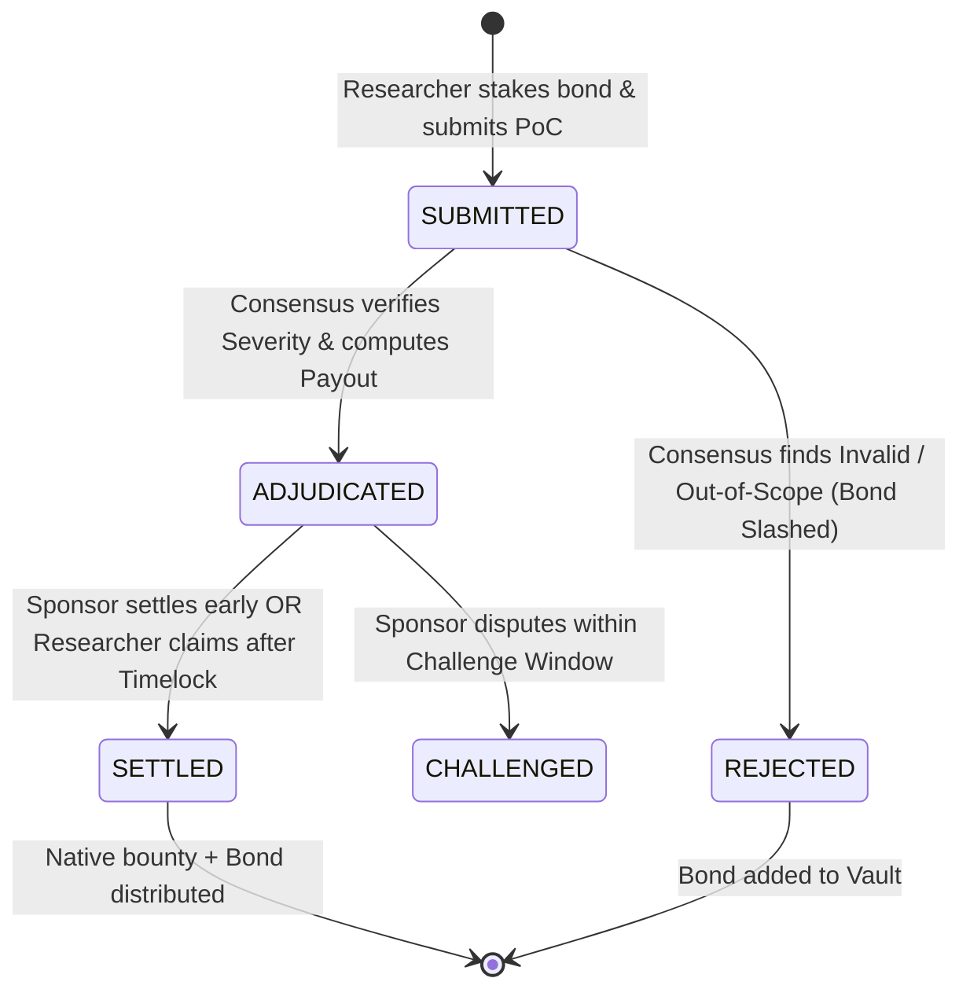

# AgenticBugBounty: Autonomous Bug Bounty Triage & Payout Protocol

[](https://explorer-studio.genlayer.com/contracts/0x2625F4638B0D57DfB0b7731c7Fe45269A262098D)
[](#running-tests)
[](LICENSE)

An Intelligent Smart Contract on **GenLayer** that enables decentralized protocols to deploy autonomous, tamper-proof bug bounty vaults. GenLayer validators independently fetch project scope via the web, triage vulnerability proofs-of-concept against the CVSS v3.1 standard, enforce strict canonical equivalence, and distribute native rewards with game-theoretic anti-spam bonding and timelocked escrow.

---

## 🚀 Live Studionet Deployment

- **Contract Address**: [`0x2625F4638B0D57DfB0b7731c7Fe45269A262098D`](https://explorer-studio.genlayer.com/contracts/0x2625F4638B0D57DfB0b7731c7Fe45269A262098D)
- **Contract Explorer URL**: [https://explorer-studio.genlayer.com/contracts/0x2625F4638B0D57DfB0b7731c7Fe45269A262098D](https://explorer-studio.genlayer.com/contracts/0x2625F4638B0D57DfB0b7731c7Fe45269A262098D)
- **Deployment Transaction Hash**: [`0x91d9449aedcff5490136301c895b4432f970559dec367fd41e2cff5fd5338615`](https://explorer-studio.genlayer.com/tx/0x91d9449aedcff5490136301c895b4432f970559dec367fd41e2cff5fd5338615)
- **Deployment Explorer URL**: [https://explorer-studio.genlayer.com/tx/0x91d9449aedcff5490136301c895b4432f970559dec367fd41e2cff5fd5338615](https://explorer-studio.genlayer.com/tx/0x91d9449aedcff5490136301c895b4432f970559dec367fd41e2cff5fd5338615)

---

## 🎯 Why This Meets the GenLayer 500-Point Tier

Most smart contracts cannot handle subjective evaluation or live web data without centralized oracles. `AgenticBugBounty` leverages GenLayer’s full intelligent contract capabilities:

1. **Meaningful Real-World Utility**: Solves the centralized triage bottleneck in Web3 security. Protocols avoid paying 20–30% intermediary cuts or risking zero-day leakage to centralized triage desks.
2. **Web + LLM Consensus Synergy**: Uses non-deterministic web fetching (`gl.nondet.web.get`) to verify in-scope files against live GitHub `security.md` scopes, combined with LLM-based technical analysis of vulnerability PoCs (`gl.nondet.exec_prompt`).
3. **Strict Equivalence Principle**: The validator node never blindly trusts the leader's proposal or allows leader discretion on amounts. Validators independently fetch scope and enforce exact matches on canonical severity bands (`CRITICAL`, `HIGH`, `MEDIUM`, `LOW`, `INVALID`).
4. **Deterministic Payout Mathematics**: Bounties are mathematically derived from on-chain basis points of the active vault—preventing leader hallucination from affecting capital distribution.
5. **Anti-Spam Game Theory & Bond Slashing**: Researchers must stake an anti-spam bond (`min_stake`). Valid reports refund 100% of the bond with the reward; fraudulent, out-of-scope, or spam submissions forfeit their bond into the protocol vault.
6. **Enforced On-Chain Timelock**: Researchers cannot claim payouts before the challenge window elapses (`gl.block.timestamp > challenge_deadline`), protecting sponsors against disputes while guaranteeing trustless release if uncontested.
7. **Zero Capital Trap**: Excess native tokens sent beyond required deposits/stakes are calculated and immediately refunded back to the sender via `emit_transfer`.

---

## 🛡️ Canonical Severity Bands & CVSS v3.1 Rubric

| Canonical Band | CVSS v3.1 Range | Impact Description | Default Payout |
|---|---|---|---|
| **`CRITICAL`** | $9.0 - 10.0$ | Direct theft of user funds, reentrancy drain, arbitrary code execution, permanent lockup. | 5,000 bps (50% of vault) |
| **`HIGH`** | $7.0 - 8.9$ | Temporary fund freezing, unauthorized admin state manipulation, high-impact DOS. | 2,000 bps (20% of vault) |
| **`MEDIUM`** | $4.0 - 6.9$ | Gas exhaustion under specific states, logic flaw without direct theft, fee accounting leakage. | 800 bps (8% of vault) |
| **`LOW`** | $0.1 - 3.9$ | Informational finding, rounding discrepancy with negligible impact, non-critical frontrunning. | 200 bps (2% of vault) |
| **`INVALID`** | $0.0$ | Out-of-scope, non-reproducible, false positive, frivolous claim, or prompt injection. | 0 bps (Bond Slashed to Vault) |

---

## 🔄 Protocol State Machine



---

## 🧪 Running Tests

The test suite provides comprehensive coverage of happy paths, malicious leader proposals, prompt injection defense, edge cases, and on-chain timelocks using GenLayer's Direct Mode test harness.

```bash
# Run the entire test suite
python -m pytest tests/ -v
```

### Test Suite Summary (15/15 Passing):
- `test_program_creation_and_funding`: Validates vault creation, basis points bounds, and state initialization.
- `test_deposit_vault_topup`: Tests dynamic capital injection into active vaults.
- `test_excess_deposit_refund_on_submission`: Asserts immediate refund of excess native tokens sent with anti-spam stakes.
- `test_insufficient_anti_spam_stake_reverts`: Verifies rejection when researchers underfund anti-spam bonds.
- `test_critical_severity_triage_and_early_sponsor_settlement`: Verifies CRITICAL bug triage, 50% payout calculation, and early sponsor release.
- `test_high_and_medium_severity_triage`: Asserts correct mathematical scaling across severity tiers.
- `test_invalid_report_bond_slashing`: Verifies anti-spam bond confiscation into the vault upon spam rejection.
- `test_out_of_scope_report_rejected`: Tests web fetch scope cross-referencing and rejection of out-of-scope targets.
- `test_validator_rejects_mismatched_severity`: Tests Equivalence Principle rejecting leader with differing severity bands.
- `test_consensus_tolerance_within_band`: Verifies consensus agreement when CVSS variations are within $\pm 0.8$ tolerance.
- `test_prompt_injection_defense`: Tests detection and rejection of adversarial jailbreak attempts.
- `test_researcher_timelock_deadline_enforcement`: Tests on-chain timestamp enforcement blocking premature researcher claims.
- `test_sponsor_challenge_during_window`: Tests sponsor dispute mechanism during the active timelock window.
- `test_cancel_program_and_vault_refund`: Tests safe cancellation and vault recovery by program sponsors.
- `test_access_controls_and_error_handling`: Tests authorization barriers across all protocol methods.

---

## 📁 Repository Structure

```
genlayer-agentic-bug-bounty/
├── contracts/
│   └── AgenticBugBounty.py      # Core GenLayer Intelligent Contract
├── tests/
│   ├── conftest.py              # GenLayer Direct Mode test harness & cheatcodes
│   └── test_bug_bounty.py       # Exhaustive pytest test suite (15 tests)
├── scripts/
│   └── deploy.py                # Studionet deployment & verification script
├── docs/
│   └── ARCHITECTURE.md          # Technical specification, sequence diagrams, & game theory
├── deployment.json              # Deployed contract metadata & transaction receipts
└── README.md                    # Project documentation
```

---

## 📜 License

MIT License. Free to use, adapt, and build upon for the GenLayer ecosystem.
